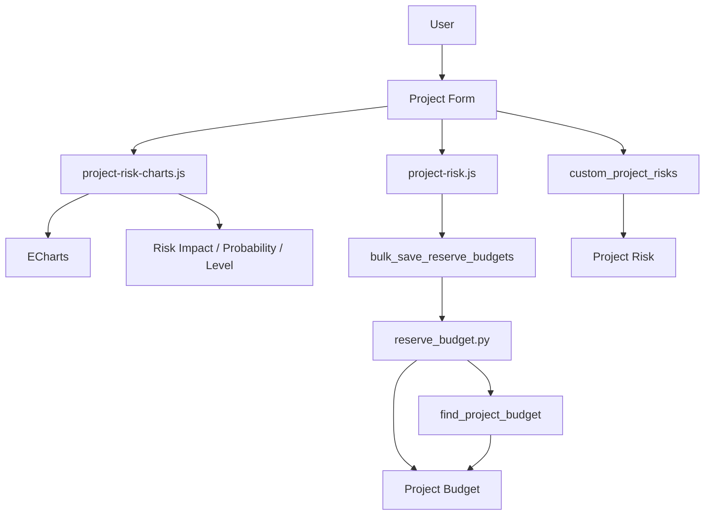

# Dinext Risk Management

## 📖 Overview

**Dinext Risk Management** — приложение для Frappe/ERPNext, которое добавляет к проектам учёт рисков, визуализацию в виде матрицы рисков и учёт контингентных резервов в бюджете проекта.

В карточке проекта появляется вкладка «Риски»: таблица рисков (тема, описание, статус, категория, приоритет, влияние, вероятность, уровень, стратегия митигации, владелец, ответственный), интерактивная матрица «вероятность × влияние» с уровнями риска и круговые диаграммы по срезам. Для каждого риска можно включить контингентный резерв — указать учётную статью (P&L), периодичность начисления (месяц/квартал/год/проект/задача), метод расчёта (фиксированная сумма или процент от базы). Резервы записываются в документы Project Budget с учётом периодов и аналитик (в т.ч. Task). При установленном приложении Dinext Projects доступны периоды бюджета и пункт меню «Рассчитать прогноз» для массового сохранения резервов.

## ✨ Features

- **Управление рисками проекта** — таблица рисков с полями: тема, описание, статус (Open / In Progress / Realized / Closed), категория, приоритет, влияние, вероятность, уровень (вычисляемый), стратегия митигации, связь с задачей, владелец и ответственный (User / Contact / User Group).
- **Матрица рисков** — интерактивная тепловая карта (Impact × Probability) с цветовыми уровнями риска, подсветкой выбранной ячейки и поддержкой светлой/тёмной темы.
- **Круговые диаграммы** — распределение рисков по категории, статусу, приоритету, влиянию, вероятности, уровню, стратегии, владельцу, ответственному; фильтрация по выбранной ячейке матрицы и по срезу в donut.
- **Контингентные резервы** — учётная статья (P&L), периодичность (месяц/квартал/год/проект/задача), метод расчёта (сумма или процент от выбранной базы); запись сумм по периодам в Project Budget.
- **Массовое сохранение резервов** — API `bulk_save_reserve_budgets`: пакетное обновление/создание Project Budget по списку резервов и опциональным родительским корректировкам прогноза.
- **Справочники** — Risk Category, Risk Priority, Risk Impact, Risk Probability, Risk Level, Risk Mitigation Strategy (поставляются через fixtures).

## 🚀 Installation

Убедитесь, что у вас есть [bench](https://github.com/frappe/bench) и настроенный сайт. Для полной функциональности периодов бюджета и пункта «Рассчитать прогноз» желательны приложения **Dinext Projects** и **Dinext Common** (ECharts).

```bash
cd $PATH_TO_YOUR_BENCH
bench get-app $URL_OF_THIS_REPO --branch develop
bench --site your_site.local install-app dinext_risk_management
```

При необходимости установите зависимые приложения (Dinext Projects, Dinext Common) до или после установки dinext_risk_management.

## 🛠️ Usage

1. Откройте карточку **Project** в Desk.
2. Перейдите на вкладку **«Риски»**: сверху отображается матрица рисков (тепловая карта и круговой график), ниже — таблица рисков.
3. **Добавление рисков**: в таблице укажите тему, описание, статус; при статусе отличном от Open заполните категорию, приоритет, влияние, вероятность (уровень подставится по справочнику), стратегию, владельца и ответственного.
4. **Матрица**: клик по ячейке фильтрует строки таблицы по паре «вероятность × влияние»; выбор среза в выпадающем списке donut также фильтрует список рисков.
5. **Контингентные резервы**: включите «Начислять резервы», укажите учётную статью начисления (P&L), периодичность, метод (Сумма или Процент) и при методе «Процент» — расчётную базу (счёт). При наличии Dinext Projects в меню формы появится пункт **«Рассчитать прогноз»** — после вызова откроется диалог с периодами и возможностью сохранить резервы в Project Budget.

## 📦 Technologies

- **Backend**: Python 3.10+, Frappe Framework
- **Frontend**: JavaScript (клиентские скрипты формы Project), ECharts (динамическая загрузка из `dinext_common`)
- **Данные**: DocType Project Risk (дочерняя таблица), справочники рисков; Custom Fields на Project (вкладка «Риски», матрица, таблица рисков); интеграция с Project Budget, Account, Task
- **Инструменты**: ruff (lint/format), pre-commit (ruff, eslint, prettier, pyupgrade)

## 🔧 Configuration

Отдельного конфигурационного файла приложения в коде нет. Настройка ведётся в стандартном интерфейсе Frappe/ERPNext:

- Справочники рисков (Risk Level, Risk Impact, Risk Probability и др.) настраиваются в соответствующих DocType; при миграции подтягиваются данные из fixtures.
- Custom Fields и скрипты модуля Dinext Risk Management также экспортируются в fixtures и применяются при миграции.
- Для доступа к определению DocType и скриптам может потребоваться включённый Developer Mode.

## ✅ Requirements

- **Frappe** (версия, совместимая с вашим bench)
- **ERPNext** или среда, в которой есть DocType: Project, Project Budget, Account, Task
- **Python** >= 3.10
- Опционально: **Dinext Projects** (периоды бюджета, меню «Рассчитать прогноз»), **Dinext Common** (ECharts для матрицы и donut)
- Для разработки: **pre-commit** (см. Contributing)

## 🤝 Contributing

Проект использует pre-commit для форматирования и проверки кода. Установите [pre-commit](https://pre-commit.com/#installation) и включите его в репозитории:

```bash
cd apps/dinext_risk_management
pre-commit install
```

В pre-commit настроены: **ruff**, **eslint**, **prettier**, **pyupgrade**.

## 📄 Documentation

- [AGENTS.md](AGENTS.md) — руководство по разработке на Frappe в рамках приложения (DocTypes, MCP, фикстуры, контроллеры, клиентские скрипты).

## ❤️ Acknowledgements

- **Dinext** — издатель приложения
- **Frappe Framework** и **ERPNext**
- **Apache ECharts** — библиотека для матрицы рисков и круговых диаграмм

## 📝 Changelog

Краткая сводка изменений по истории коммитов:

- **Инициализация и база**: Initial commit, Initialize App; добавление модуля Dinext Risk Management с DocTypes (Project Risk, Risk Category, Risk Priority, Risk Impact, Risk Probability, Risk Level, Risk Mitigation Strategy) и fixtures.
- **Матрица рисков**: добавление и доработка UI матрицы рисков на форме Project (тепловая карта, расчёт контрастного цвета подписи, поддержка светлой/тёмной темы, адаптивная вёрстка, resize observer); донат-чарты с выбором типа (категория, статус, приоритет, влияние, вероятность, уровень, стратегия, владелец, ответственный), палитры цветов для light/dark; фильтрация по выбранной ячейке матрицы и по срезу donut; правки разметки, отступов и пустых подписей.
- **Контингентные резервы**: поля резервов в Project Risk (учётная статья, периодичность, метод сумма/процент, база); диалог резервов и интеграция расчёта в форму проекта; логика периодов (месяц/квартал/год/проект/задача), использование `get_budget_display_periods` при наличии; рефакторинг функций расчёта резервов и массовое сохранение через API.
- **Интеграция с бюджетом**: реализация `reserve_budget.py` (поиск/создание Project Budget по проекту, счёту и размерностям; добавление резервов и установка прогноза по периодам); whitelist `bulk_save_reserve_budgets` для пакетного сохранения с фронта; доработка обработки размерностей и пакетных обновлений.
- **Прочее**: обновление JSON Project Risk (link filters, зависимости полей); условное отображение пункта меню «Рассчитать прогноз»; правки fixtures и визуализации; удаление неиспользуемого файла project_pl.js (chore).

## 🗂️ Repository Structure

```
dinext_risk_management/
├── .cursor/skills/readme-writer/   # Skill для генерации README
├── .editorconfig
├── .eslintrc
├── .pre-commit-config.yaml
├── AGENTS.md                       # Руководство по разработке
├── README.md
├── license.txt
├── pyproject.toml                  # Метаданные и зависимости Python, ruff
├── dinext_risk_management/        # Корень приложения Frappe
│   ├── __init__.py                # Версия приложения
│   ├── hooks.py                    # Конфигурация: fixtures, doctype_js, app_include_css
│   ├── modules.txt
│   ├── patches.txt
│   ├── config/                    # Конфигурация Desk
│   ├── dinext_risk_management/    # Модуль приложения
│   │   ├── __init__.py
│   │   ├── reserve_budget.py       # API резервов, запись в Project Budget
│   │   └── doctype/
│   │       ├── project_risk/       # Дочерняя таблица рисков проекта
│   │       ├── risk_category/
│   │       ├── risk_priority/
│   │       ├── risk_impact/
│   │       ├── risk_probability/
│   │       ├── risk_level/
│   │       └── risk_mitigation_strategy/
│   ├── fixtures/                  # Экспорт: справочники, custom_field, client/server script, role
│   ├── public/
│   │   ├── css/project_risk_matrix.css
│   │   └── js/
│   │       ├── project-risk.js     # Резервы, периоды, диалог «Рассчитать прогноз»
│   │       └── project-risk-charts.js  # Матрица рисков и donut (ECharts)
│   ├── templates/
│   └── www/
```

- **dinext_risk_management/** — корневая папка приложения: `hooks.py` задаёт fixtures, подключение JS/CSS к форме Project и глобальные стили матрицы.
- **dinext_risk_management/dinext_risk_management/** — Python-модуль: `reserve_budget.py` — расчёт и запись резервов в Project Budget, whitelist `bulk_save_reserve_budgets`; **doctype/** — DocType Project Risk (child table) и справочники рисков (JSON, контроллеры, тесты).
- **fixtures/** — данные для миграции: справочники рисков, Custom Field (вкладка «Риски», матрица, таблица `custom_project_risks`), Client Script, Server Script, Role.
- **public/js/** — клиентская логика формы Project: резервы по периодам и сохранение в бюджет (`project-risk.js`), матрица и donut с ECharts (`project-risk-charts.js`).
- **public/css/** — стили блока матрицы рисков (сетка, панель donut, адаптивность).

## 🔗 Flow Chart

Взаимодействие компонентов при работе с рисками и резервами:



- Пользователь работает с формой Project (вкладка «Риски»). Таблица рисков (`custom_project_risks`) и скрипты `project-risk-charts.js` / `project-risk.js` загружаются для этой формы.
- Матрица и donut строятся по данным Risk Impact, Risk Probability, Risk Level и таблице рисков; ECharts подгружается динамически (dinext_common).
- При сохранении резервов фронт вызывает `bulk_save_reserve_budgets`; серверный модуль `reserve_budget.py` находит или создаёт документы Project Budget (по проекту, счёту и размерностям) и записывает суммы по периодам.

## License

GNU GPL v3. Текст — в [license.txt](license.txt).
