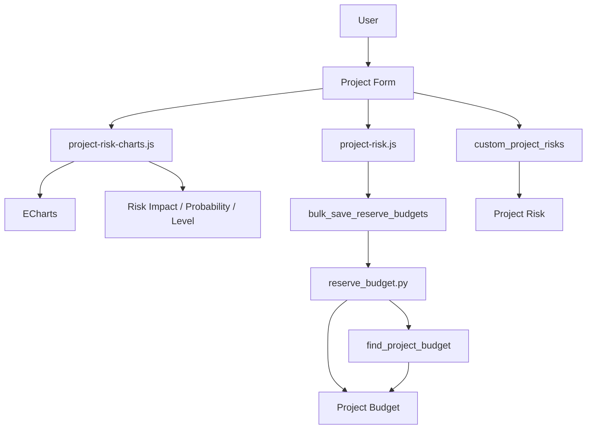

[Русский](README.ru.md)

# Dinext Risk Management

## 📖 Overview

**Dinext Risk Management** is a Frappe/ERPNext application that adds project risk tracking, risk matrix visualization and contingency reserve accounting in the project budget.

The project form gains a Risks tab: a risk table (subject, description, status, category, priority, impact, probability, level, mitigation strategy, owner, responsible party), an interactive probability × impact matrix with risk levels, and pie charts by dimension. A contingency reserve can be enabled for each risk by specifying the accounting item (P&L), accrual frequency (month/quarter/year/project/task), and calculation method (fixed amount or percentage of a base). Reserves are recorded in Project Budget documents with periods and dimensions (including Task). When Dinext Projects is installed, budget periods and the Calculate Forecast menu item are available for saving reserves in bulk.

## ✨ Features

- **Project risk management** — a risk table with the following fields: subject, description, status (Open / In Progress / Realized / Closed), category, priority, impact, probability, level (calculated), mitigation strategy, task link, owner and responsible party (User / Contact / User Group).
- **Risk matrix** — an interactive heatmap (Impact × Probability) with color-coded risk levels, highlighting of the selected cell, and light/dark theme support.
- **Pie charts** — risk distribution by category, status, priority, impact, probability, level, strategy, owner and responsible party; filtering by the selected matrix cell and donut segment.
- **Contingency reserves** — accounting item (P&L), frequency (month/quarter/year/project/task), calculation method (amount or percentage of a selected base); recording amounts by period in Project Budget.
- **Bulk reserve saving** — the `bulk_save_reserve_budgets` API: batch updating/creating Project Budget records from a list of reserves and optional parent forecast adjustments.
- **Reference data** — Risk Category, Risk Priority, Risk Impact, Risk Probability, Risk Level, Risk Mitigation Strategy (supplied through fixtures).

## 🚀 Installation

Make sure you have [bench](https://github.com/frappe/bench) and a configured site. **Dinext Projects** and **Dinext Common** (ECharts) are recommended for full budget period and Calculate Forecast functionality.

```bash
cd $PATH_TO_YOUR_BENCH
bench get-app $URL_OF_THIS_REPO --branch develop
bench --site your_site.local install-app dinext_risk_management
```

If necessary, install the dependent applications (Dinext Projects, Dinext Common) before or after installing dinext_risk_management.

## 🛠️ Usage

1. Open a **Project** form in Desk.
2. Go to the **Risks** tab: the risk matrix (heatmap and pie chart) appears at the top, with the risk table below.
3. **Adding risks**: enter a subject, description and status in the table; for any status other than Open, fill in the category, priority, impact, probability (the level is populated from reference data), strategy, owner and responsible party.
4. **Matrix**: clicking a cell filters table rows by the probability × impact pair; choosing a segment in the donut dropdown also filters the risk list.
5. **Contingency reserves**: enable Accrue Reserves, specify the accrual accounting item (P&L), frequency and method (Amount or Percentage); for Percentage, specify the calculation base (account). When Dinext Projects is available, the form menu includes **Calculate Forecast**: selecting it opens a dialog with periods and an option to save reserves in Project Budget.

## 📦 Technologies

- **Backend**: Python 3.10+, Frappe Framework
- **Frontend**: JavaScript (Project form client scripts), ECharts (loaded dynamically from `dinext_common`)
- **Data**: Project Risk DocType (child table), risk reference data; Custom Fields on Project (Risks tab, matrix, risk table); integration with Project Budget, Account, Task
- **Tools**: ruff (lint/format), pre-commit (ruff, eslint, prettier, pyupgrade)

## 🔧 Configuration

There is no separate application configuration file in the code. Configuration is managed through the standard Frappe/ERPNext interface:

- Risk reference data (Risk Level, Risk Impact, Risk Probability, etc.) is configured in the corresponding DocTypes; fixture data is loaded during migration.
- Custom Fields and scripts in the Dinext Risk Management module are also exported to fixtures and applied during migration.
- Developer Mode may be required to access DocType definitions and scripts.

## ✅ Requirements

- **Frappe** (a version compatible with your bench)
- **ERPNext**, or an environment containing these DocTypes: Project, Project Budget, Account, Task
- **Python** >= 3.10
- Optional: **Dinext Projects** (budget periods, Calculate Forecast menu), **Dinext Common** (ECharts for the matrix and donut)
- For development: **pre-commit** (see Contributing)

## 🤝 Contributing

The project uses pre-commit for code formatting and checks. Install [pre-commit](https://pre-commit.com/#installation) and enable it in the repository:

```bash
cd apps/dinext_risk_management
pre-commit install
```

The pre-commit configuration includes **ruff**, **eslint**, **prettier**, **pyupgrade**.

## 📄 Documentation

- [AGENTS.md](AGENTS.md) — the guide to Frappe development within the application (DocTypes, MCP, fixtures, controllers, client scripts).

## 📝 Changelog

A brief summary of changes from the commit history:

- **Initialization and foundation**: Initial commit, Initialize App; addition of the Dinext Risk Management module with DocTypes (Project Risk, Risk Category, Risk Priority, Risk Impact, Risk Probability, Risk Level, Risk Mitigation Strategy) and fixtures.
- **Risk matrix**: addition and refinement of the risk matrix UI on the Project form (heatmap, contrasting label color calculation, light/dark theme support, responsive layout, resize observer); donut charts with a dimension selector (category, status, priority, impact, probability, level, strategy, owner, responsible party), light/dark color palettes; filtering by the selected matrix cell and donut segment; markup, spacing and empty-label fixes.
- **Contingency reserves**: reserve fields in Project Risk (accounting item, frequency, amount/percentage method, base); reserve dialog and calculation integration in the project form; period logic (month/quarter/year/project/task), use of `get_budget_display_periods` when available; refactoring of reserve calculation functions and bulk saving through the API.
- **Budget integration**: implementation of `reserve_budget.py` (finding/creating Project Budget records by project, account and dimensions; adding reserves and setting forecasts by period); whitelisted `bulk_save_reserve_budgets` for batch saving from the frontend; refinement of dimension handling and batch updates.
- **Other**: Project Risk JSON updates (link filters, field dependencies); conditional display of the Calculate Forecast menu item; fixture and visualization changes; removal of the unused project_pl.js file (chore).

## 🗂️ Repository Structure

```
dinext_risk_management/
├── .cursor/skills/readme-writer/   # README generation skill
├── .editorconfig
├── .eslintrc
├── .pre-commit-config.yaml
├── AGENTS.md                       # Development guide
├── README.md
├── license.txt
├── pyproject.toml                  # Python metadata and dependencies, ruff
├── dinext_risk_management/        # Frappe application root
│   ├── __init__.py                # Application version
│   ├── hooks.py                    # Configuration: fixtures, doctype_js, app_include_css
│   ├── modules.txt
│   ├── patches.txt
│   ├── config/                    # Desk configuration
│   ├── dinext_risk_management/    # Application module
│   │   ├── __init__.py
│   │   ├── reserve_budget.py       # Reserve API, writing to Project Budget
│   │   └── doctype/
│   │       ├── project_risk/       # Project risk child table
│   │       ├── risk_category/
│   │       ├── risk_priority/
│   │       ├── risk_impact/
│   │       ├── risk_probability/
│   │       ├── risk_level/
│   │       └── risk_mitigation_strategy/
│   ├── fixtures/                  # Exports: reference data, custom_field, client/server script, role
│   ├── public/
│   │   ├── css/project_risk_matrix.css
│   │   └── js/
│   │       ├── project-risk.js     # Reserves, periods, Calculate Forecast dialog
│   │       └── project-risk-charts.js  # Risk matrix and donut (ECharts)
│   ├── templates/
│   └── www/
```

- **dinext_risk_management/** — application root: `hooks.py` defines fixtures, JS/CSS inclusion on the Project form and global matrix styles.
- **dinext_risk_management/dinext_risk_management/** — Python module: `reserve_budget.py` calculates and writes reserves to Project Budget, with the whitelisted `bulk_save_reserve_budgets`; **doctype/** contains the Project Risk DocType (child table) and risk reference data (JSON, controllers, tests).
- **fixtures/** — migration data: risk reference data, Custom Field (Risks tab, matrix, `custom_project_risks` table), Client Script, Server Script, Role.
- **public/js/** — Project form client logic: reserves by period and budget saving (`project-risk.js`), matrix and donut with ECharts (`project-risk-charts.js`).
- **public/css/** — risk matrix block styles (grid, donut panel, responsiveness).

## 🔗 Flow Chart

Component interaction when working with risks and reserves:



- The user works with the Project form (Risks tab). The risk table (`custom_project_risks`) and the `project-risk-charts.js` / `project-risk.js` scripts are loaded for this form.
- The matrix and donut are built from Risk Impact, Risk Probability, Risk Level and risk table data; ECharts is loaded dynamically (dinext_common).
- When saving reserves, the frontend calls `bulk_save_reserve_budgets`; the server module `reserve_budget.py` finds or creates Project Budget documents (by project, account and dimensions) and writes amounts by period.

## License

GNU GPL v3. See [license.txt](license.txt) for the license text.
